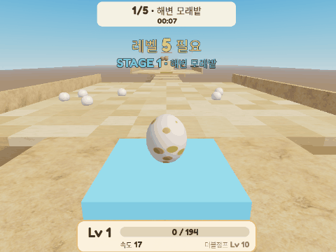

# Egg Sand Escape 🥚

> A Roblox obby where you play as an egg. Every sand tile you step on gives +1 XP, levels make you faster, level 10 unlocks a double jump, and resting in the nest levels you up while idle. Built fully in code with **Rojo + Luau**.

알이 되어 모래 위를 달리는 로블록스 오비입니다. 모래 타일을 밟을 때마다 +1, 레벨이 오르면 빨라지고, 레벨 10부터 더블점프, 둥지에 있으면 방치해도 자랍니다. 다섯 스테이지를 지나 피라미드 꼭대기 황금 둥지에 도착하면 클리어입니다.

<p align="center">
  
</p>

## 게임 구성

| 요소 | 내용 |
|---|---|
| 캐릭터 | Blender로 만든 점박이 공룡알(`assets/EggModel.rbxm`). 이동한 만큼 굴러가고 멈추면 똑바로 섬. 둥지에서는 부화하려는 듯 떨림. Lv25 금빛 |
| 모래 타일 | 다른 타일로 옮겨 밟을 때마다 XP +1 (같은 타일 0.35초 쿨다운, 초당 상한 12) |
| 레벨 | 다음 레벨까지 `185 + 9 × 레벨` XP. 속도 `16 + 레벨` (최대 60) |
| 더블점프 | Lv10부터. PC 스페이스바·모바일 점프 버튼 |
| 둥지 | 머물면 5초마다 +1 (방치 성장) |
| 스테이지 | ① 해변 모래밭 ② 사구 언덕(Lv5) ③ 유사 늪(Lv10, 더블점프 턱) ④ 모래폭풍(Lv18, 옆바람) ⑤ 피라미드 정상(Lv25) |
| 위험 | 유사 바다(가라앉음), 쓸고 다니는 모래공, 가라앉는 발판 |
| 관리자 | 채팅 `/lvl +5` `/setlvl 18` `/xp 500` `/stage 3` `/reset` `/speed 60` `/dj on` `/nest x10` + 관리자 패널 |
| 기록 | 클리어 타이머, 최고 기록, DataStore 저장, AnalyticsService 스테이지 퍼널 |

## 구조

```
src/
├─ shared/   → ReplicatedStorage.Shared
│  ├─ Config.luau      모든 수치 (레벨 곡선·속도·스테이지·관리자)
│  ├─ LevelMath.luau   순수 계산 함수 (Lune으로 테스트)
│  └─ Remotes.luau     RemoteEvent 참조
├─ server/   → ServerScriptService.Server
│  ├─ init.server.luau      진입점·플레이어 수명 주기
│  ├─ MapBuilder            5스테이지 테스트 맵을 코드로 생성
│  ├─ EggCharacter          StarterCharacter(알) 생성·색칠
│  ├─ PlayerDataService     DataStore 저장 (실패 시 메모리)
│  ├─ LevelService          XP·레벨·속도·더블점프 자격
│  ├─ SandTileService       발밑 레이캐스트로 타일 판정
│  ├─ NestService           둥지 방치 XP
│  ├─ StageService          체크포인트·게이트 우회 방지·클리어
│  ├─ HazardService         유사·모래공·가라앉는 발판
│  ├─ RunTimerService       클리어 시간·최고 기록·배지
│  ├─ AdminService          관리자 명령 (서버 권한 확인)
│  └─ FunnelService         AnalyticsService 래퍼
└─ client/   → StarterPlayerScripts.Client
   ├─ HudController · PopupController · DoubleJumpController
   ├─ EggWobbleController · WindController · GateController
   └─ AdminPanelController
tests/LevelMath.spec.luau
```

## 실행

```bash
rokit install
rojo serve
```

1. Roblox Studio에서 빈 **Baseplate**를 엽니다.
2. Rojo 플러그인에서 **Connect**를 누릅니다.
3. **Play**를 누르면 맵이 코드로 생성되고 알 캐릭터로 스폰됩니다.

Studio에서 DataStore를 쓰려면 *Game Settings → Security → Enable Studio Access to API Services*를 켭니다. 꺼져 있으면 자동으로 메모리 저장으로 진행합니다.

관리자: Studio에서는 자동으로 관리자입니다. 공개 서버에서는 `Config.AdminUserIds`에 UserId를 넣습니다.

## 검사

```bash
stylua --check src tests
selene src
lune run tests/LevelMath.spec.luau
```

GitHub Actions(`.github/workflows/ci.yml`)가 푸시마다 같은 검사를 돌립니다.

## 설계 결정

1. **서버 권한.** XP·레벨·스테이지는 서버만 바꿉니다. 클라이언트는 Attribute를 읽어 화면에 그리고, 게이트도 화면에서만 엽니다. 우회는 서버가 다음 체크포인트에서 레벨로 다시 확인합니다. 타일 판정도 클라이언트 신호가 아니라 서버의 발밑 레이캐스트입니다.
2. **수치는 Config 한 곳.** 레벨 곡선을 시뮬레이션으로 정했고, 테스트가 그 값을 지킵니다. 플레이 테스트 뒤에는 `XpBase`·`XpPerLevel` 두 숫자만 고칩니다.
3. **코드로 만든 캐릭터와 맵.** 알 캐릭터와 테스트 맵을 코드로 생성해 바이너리 에셋 없이 저장소만으로 재현됩니다. 장식 맵을 따로 만들 때는 같은 태그(`SandTile`, `Checkpoint`, `Gate`, `WindZone`…)만 붙이면 됩니다.

## 다음 할 일

- [ ] Studio 플레이 테스트로 레벨 곡선 조정
- [x] 30초 플레이 GIF
- [x] Blender 공룡알 모델(`assets/`)과 굴러가는 움직임
- [ ] 오프라인 둥지 보상(최대 2시간)
- [ ] 알 껍질 꾸미기, 클리어 후 「부화」 연출
- [ ] 금 간 껍질 데칼(에셋 업로드 필요)
